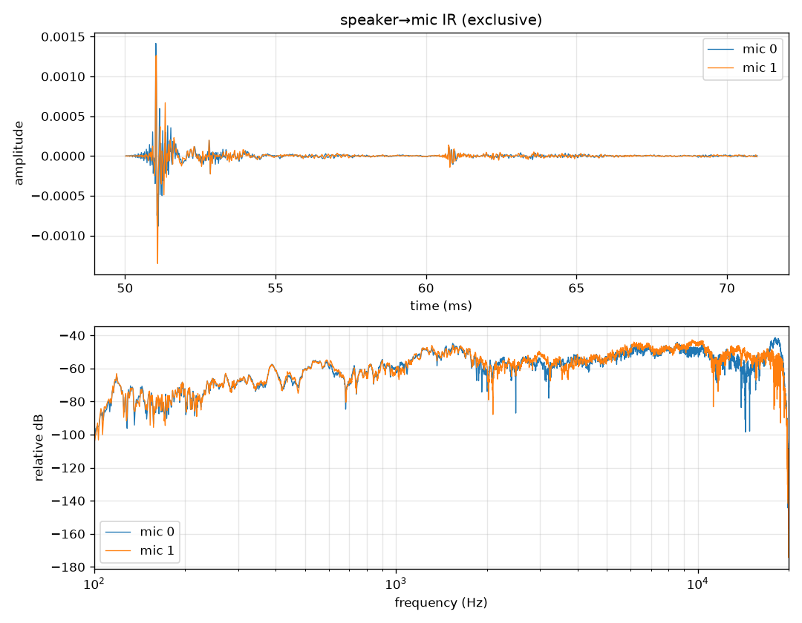

# Phase 0 — Device audit & measurement tooling

Task: [T-001](../tasks/T-001-phase0-device-audit.md) · Status: exclusive-mode measurements
done (§2); optional runs listed in §2.5 · Raw audit data: [`data/audit.json`](data/audit.json)

## 1. Audit results (measured 2026-10-18, no audio played)

| | shared | shared-raw | exclusive | wdmks |
|---|---|---|---|---|
| Mic device | Microphone Array (AMD Audio Device) | same | same | Microphone Array 1 (AMDAfdInstall) |
| Mic channels | 1, 2, **4** | 1, 2 | 1, 2 | 1, 2 |
| Mic sample rates | 48 kHz | 48 kHz | 48 kHz | 48 kHz |
| Speaker rates | 48 kHz | 48 kHz | 16 / 44.1 / 48 / 96 kHz | 48 kHz |
| Min. stream latency in / out (PortAudio-reported) | 22 / 22 ms | 22 / 22 ms | 10 / 10 ms | 1.4 / 0.25 ms |

- **2 physical mics.** The 4-channel shared format is what the Dolby APO outputs, not 4 mics.
- **Native mic format is 16-bit** (exclusive, explicit format); speakers take 16- or 24-bit.
- **Processing in the chain:** Dolby APO on capture, Realtek APO on render, "Audio
  enhancements" enabled on both. Both endpoints advertise raw-mode support.
- Exclusive mode works on both endpoints. Reported latencies are what PortAudio asks the
  driver for. Real round-trip latency has to be measured (`latency`, below), and the WDM-KS
  figures in particular are optimistic.

### Early physics flag (Phase 2 makes the call)
With exclusive mode the round trip is at least ~20 ms before any acoustic path. Feedback
control needs loop delay well under a period of the controlled frequency (Elliott 2001, ch. 6),
which at 20 ms limits it to a few hertz, far below what the speakers can reproduce. So broadband
feedback looks infeasible unless WDM-KS really delivers ~2 ms. Tonal control with a synthesized
reference does not depend on causality in the same way (Kuo & Morgan 1996, ch. 4). The
zone of quiet (~λ/10: 11 cm at 300 Hz, 3.4 cm at 1 kHz) forms at the mics, ~50 cm from your
ears. That is likely the binding constraint.

## 2. Hardware results (measured 2026-10-18)

### 2.1 Raw-mode proof (`rawcheck`)
| | shared | shared-raw | exclusive |
|---|---|---|---|
| 1 kHz tone, mic 0 / mic 1 | -133 dBFS (all 4 ch identical) | -33.4 / -32.5 dBFS | -41.9 / -41.1 dBFS |
| Max tone deviation over 7 s | n/a | 0.15 / 0.37 dB | 0.15 / 0.15 dB |
| Silence floor | -99.5 dBFS (flat) | -72.9 dBFS | -81.9 dBFS |
| Bit-exact int16 | no | no | **yes** |
| Gain vs exclusive | ≈ -91 dB | +6.6 dB, then +8.6 dB | 0 (repeats to 0.02 dB) |

- **Shared mode is unusable.** The Dolby APO cancels the speaker signal at the mics: it does
  echo cancellation against the render stream, plus noise suppression.
- **Shared-raw** bypasses the APO, so nothing adapts within a run. But the audio engine
  applies a gain that changed by 2 dB between two runs minutes apart.
- **Decision: exclusive mode (WASAPI exclusive + raw) is the capture path from here on.** It
  is bit-exact, its level repeats, and its floor is the lowest.
- WDM-KS was not run (driver-wedge suspect, and exclusive already gives the answer).

### 2.2 Round-trip latency (`latency --mode exclusive`)
- **50.92 ms (2444 samples)** on both mics, all 5 bursts, spread 0 samples, GCC-PHAT peak
  ratio 160–173.
- PortAudio reports 21.3 ms in + 31.3 ms out = 52.7 ms. The measured value agrees, so almost
  all of the delay is buffering in the driver and engine. The acoustic path from speaker to
  bezel mic is ~1 ms (~30 cm at 343 m/s).
- The audit's 10 ms per-direction minimum is not what this duplex stream got.

### 2.3 Secondary path (`ir --mode exclusive`, both speakers)

- **Delay:** first arrival at sample 2444 (50.92 ms), the same as `latency`. Main peak at 2449
  (51.03 ms). Mic 1 peaks 3 samples after mic 0 (~2 cm extra path).
- **Shape:** the energy decay curve is -15 dB at 5 ms after the peak and -36 dB at 100 ms. A
  distinct reflection arrives ~9.8 ms after the direct sound (~3.4 m extra path, a wall or
  the ceiling). Peak-to-tail ratio is 81 / 80 dB, so the measurement SNR is ample.
- **Frequency response** (band power relative to 1–4 kHz; speaker, room and mic together):

  | band | 100–150 Hz | 150–200 | 200–300 | 300–500 | 500–700 | 700–1k | 1–2k | 2–4k | 4–8k | 8–16k |
  |---|---|---|---|---|---|---|---|---|---|---|
  | mic 0 (dB) | -20 | -22 | -16 | -11 | -5 | -6 | +3 | -3 | +4 | +3 |

  The plot shows the narrowband level near 120 Hz at roughly 30 dB below the 1–2 kHz plateau.
  Nothing below 100 Hz was measured (the sweep starts at 100 Hz for speaker safety).
- **Clock:** over repeats 1–3 the peak moved 0.04 samples in 9 s (≈0.1 ppm). Repeat 4 then
  jumped **+1.93 samples** all at once. The reported `clock_drift_ppm` of 2.7 is a linear fit
  over that jump, so it describes a step, not a steady drift. A step like this looks like a
  sample slip or resync between the AMD ACP capture clock and the Realtek render clock, but
  4 repeats can't establish it.

### 2.4 What this means for the ANC design (Phase 2 decides formally)
- **Broadband feedback control: no.** A 51 ms loop delay gives 180° of phase lag at 1/(2τ) ≈
  9.8 Hz. The usable feedback bandwidth is a few hertz at most (Elliott 2001, ch. 6). This
  confirms the earlier flag, now with a measured delay 2.5× worse than assumed.
- **Broadband feedforward with the built-in mics as reference: no.** Sound reaches the ear
  ~1.5 ms after it passes the bezel mics (~50 cm), but the anti-noise needs 51 ms to come
  out. The controller would need to know the noise ~50 ms before it happens, which is
  acausal for anything that isn't predictable (Kuo & Morgan 1996, ch. 3).
- **Tonal (periodic) noise with a synthesized reference: still open.** For stationary tones
  the delay only slows adaptation and tracking; it does not prevent cancellation (Kuo &
  Morgan 1996, ch. 4). So the candidate scope is steady tones only (fans, HVAC, transformer
  hum harmonics).
- **What will bind next:** speaker output, ~20–30 dB down at 100–200 Hz and unmeasured below
  100 Hz. Also the zone of quiet, which forms at the mics, not at the ears (§1 flag). Phase 1
  shows whether the room's noise has tones where the speakers can reach.
- **Secondary-path model:** a 2444-sample bulk delay plus a short FIR (~5–20 ms) will
  probably fit. The +2-sample step is 15° of phase at 1 kHz and 4° at 300 Hz, within FxLMS's
  ~90° phase-error tolerance (Kuo & Morgan 1996). It only becomes a problem if steps keep
  accumulating over minutes.

### 2.5 Not yet run (optional)
- `latency --mode shared`: only shows how much Windows buffering adds. Shared mode is ruled
  out anyway.
- `ir --speaker left` / `--speaker right`: matters only if Phase 3 wants one speaker.
- `rawcheck --modes wdmks` / `latency --mode wdmks`: WDM-KS reports 1.4 / 0.25 ms. If true,
  feedback control would be back in play, but this is the driver-wedge suspect. Worth one
  careful try (save your work first).
- A longer `ir --repeats 40` (~3 min) to tell whether the +2-sample step is a recurring
  clock slip or a one-off.

## 3. What each measurement does
Each command answers a question the later phases depend on.

### `rawcheck`: are the mics really unprocessed?
- **Plays:** 2 s silence → 8 s 1 kHz tone at −24 dBFS → 2 s silence, once per capture mode
  (~12 s each). Always through the same shared render path, so only the capture side differs.
- **Checks:** a processed path shows up as one of these:
  - **AGC / noise suppression:** tone level drifts or decays over the 8 s (pass: < 1 dB).
  - **AEC:** tone suppressed relative to exclusive mode (pass: no more than 3 dB below).
  - **Gating:** a run of exact zeros >= 10 ms, or a silence floor that drops after the tone.
- **Result:** `unprocessed` or `PROCESSED?` per mode.
- **Why:** the controller needs a mic signal nothing else alters. An adaptive Dolby stage
  underneath FxLMS would stop it converging. This replaces the registry's
  `RawProcessingSupported` claim with a measurement. WDM-KS runs separately because it is the
  suspect for the driver wedge.

### `latency`: how long from speaker to mic?
- **Plays:** 5 noise bursts of 0.5 s at −18 dBFS (~6 s), on one duplex stream.
- **Measures:** the delay by GCC-PHAT (Knapp & Carter 1976): the full round trip of output
  buffer + DAC + air path + ADC + input buffer. Shared vs exclusive shows how much is Windows
  buffering.
- **Why:** loop delay bounds the bandwidth of feedback control (Elliott 2001, ch. 6) and
  decides whether broadband feedforward control can be causal. Tonal control with a
  synthesized reference tolerates it (Kuo & Morgan 1996, ch. 4). See the physics flag above.

### `ir`: what does the speaker→mic path look like?
- **Plays:** 4 exponential sweeps, 100 Hz → 20 kHz, 3 s each at −18 dBFS with 1.5 s gaps
  (~20 s). Run three times: both speakers, `--speaker left`, `--speaker right`.
- **Measures:** speaker→each-mic impulse responses by Farina deconvolution (Farina 2000):
  delay, frequency response, SNR and per-repeat delay drift (`clock_drift_ppm`).
- **Why:** this is the secondary path FxLMS has to model (Kuo & Morgan 1996), and what the
  Phase 3 offline simulation runs on. It shows how little low-frequency output the speakers
  have, usually the binding limit for ANC. Left vs right shows whether the speakers reach the
  mics differently. Delay drift shows whether the mic (AMD ACP) and speakers (Realtek HDA)
  share a clock.

### `record`: what noise is there to cancel?
- **Plays:** nothing. Records the raw mics for 10 min.
- **Why:** the Phase 1 input: noise spectrum, tonal vs broadband, and how steady it is over a
  working day. Only steady, low-frequency, largely tonal noise is a realistic ANC target.

### Safety
Levels are −18 to −24 dBFS, under the −6 dBFS cap in `noisy/capture.py`; sweeps start at
100 Hz. Exclusive mode bypasses the Realtek render APO (see `GOTCHAS.md`), so keep Windows
volume at the noted value. Exclusive mode also takes the device away from other apps while it
runs.

## 4. What I need you to run

**Before you start**
1. **Reboot.** My smoke test left the mic driver wedged (see `GOTCHAS.md`). Nothing will open
   until the audio stack is reset.
2. Close anything that uses audio (Teams, browser tabs with media), and **turn Bluetooth off**
   (headphones/soundbar connecting mid-run change the device set, see `GOTCHAS.md`).
3. Set Windows volume to a fixed value (suggest **40 %**), note it, and keep it for every phase.
   Levels are only comparable at the same volume.

**Placement (keep identical across all sessions)**
4. Put the laptop where you normally work, lid at your normal angle. Mark the base corners
   with tape so you can put it back in exactly the same place.
5. Note, roughly to ±5 cm: distance from the laptop's top bezel (the mics) to your ears when
   seated normally; and the direction and distance of the main noise source (HVAC vent,
   fan, window, ...).
6. Sit as you normally do. Stay quiet and still during steps 8–11 (no typing).

**Measurements** (from the repo root; each prints a summary and saves to `data/`)
7. `uv run python -m noisy audit` (silent, confirms the stack is healthy after the reboot)
8. `uv run python -m noisy rawcheck --modes shared shared-raw exclusive` (~40 s, quiet tone)
9. `uv run python -m noisy rawcheck --modes wdmks` (run separately; WDM-KS is the suspect for
   the wedge. If it hangs, reboot and skip it.)
10. `uv run python -m noisy latency --mode shared` then `--mode exclusive`
11. `uv run python -m noisy ir --mode exclusive`, then again with `--speaker left` and
    `--speaker right`
12. Ambient recordings for Phase 1: `uv run python -m noisy record --seconds 600 --label <time>-<what's-on>`.
    Do 4–6 of these across a working day (e.g. 09h, 11h, 14h, 17h), writing down which noise
    sources were active. Typing is fine here, but note it.

Then send me the printed summaries, or just tell me they're done; the JSON files in `data/`
have everything.

## 5. Open risks
- ~~Whether raw/exclusive bypass all processing.~~ Exclusive is bit-exact and stable (§2.1).
  DSP in the ACP firmware that keeps a tone flat to 0.15 dB with an exact repeat can't be
  ruled out entirely, but nothing adaptive is visible.
- Mic and speaker clocks: one +1.93-sample step in 13.5 s (§2.3). Unknown whether it recurs.
  Needs a longer `ir` run.
- Loop delay of 51 ms rules out broadband control (§2.4). Unless WDM-KS really is low-latency,
  this caps the project at tonal noise.
- Capture-driver stability (the wedge). If it recurs in WASAPI modes too, long recordings
  and the real-time loop are at risk.
